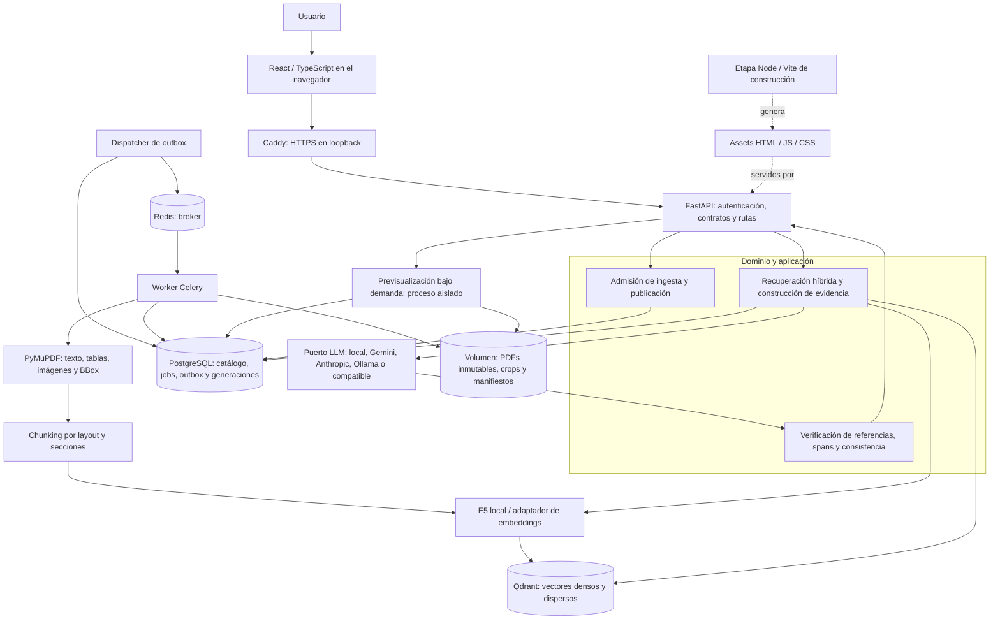

# AetherRAG: consulta multimodal de documentos técnicos

AetherRAG procesa PDFs técnicos con texto, tablas, imágenes y esquemas vectoriales. Permite consultar el corpus en lenguaje natural y presenta evidencia con documento, página, citas y figuras relacionadas. Implementa una API FastAPI, un cliente React/TypeScript y una ingesta asíncrona con Celery, PostgreSQL, Redis y Qdrant.

La entrega es independiente de la infraestructura del autor. Cada instalación crea su administrador, contraseñas, sesiones y datos. No requiere claves de API para recorrer el flujo de ingesta y recuperación: incluye embeddings multilingües locales y un generador extractivo. Para redactar explicaciones o interpretar píxeles se configura un modelo generativo compatible.

## Contenido

- [Inicio rápido](#inicio-rápido)
- [Recorrido de evaluación](#recorrido-de-evaluación)
- [Arquitectura lógica](#arquitectura-lógica)
- [Decisiones técnicas](#decisiones-técnicas)
- [Configuración y proveedores](#configuración-y-proveedores)
- [API y contratos](#api-y-contratos)
- [Pruebas y verificaciones](#pruebas-y-verificaciones)
- [Rendimiento y operación](#rendimiento-y-operación)
- [Seguridad y aislamiento](#seguridad-y-aislamiento)
- [Resolución de problemas](#resolución-de-problemas)
- [Alcance y límites](#alcance-y-límites)

## Inicio rápido

### Requisitos

- Git y acceso autorizado a este repositorio privado.
- Docker Engine con Compose 2.20 o posterior, o Docker Desktop con contenedores Linux.
- Internet para la primera descarga de imágenes, dependencias y pesos de embeddings.
- Como presupuesto orientativo, 4 CPU y 6 GiB de memoria para Docker permiten probar el perfil de rendimiento. La necesidad real depende del corpus; no constituye un mínimo universal ni una garantía de latencia.
- En Windows, Docker Desktop necesita WSL 2 y virtualización habilitada. La construcción y el stack se verifican en Linux x86_64; no se acredita una prueba directa en todos los equipos Windows, macOS o ARM.

Python y Node en el host son opcionales para ejecutar la entrega con Docker. La imagen final utiliza Python 3.12; Node 22 solo participa en la compilación del cliente.

### 1. Obtener el código

```bash
git clone https://github.com/NeoCode313/aetherrag.git
cd aetherrag
```

Usa la autenticación de GitHub que hayas autorizado para tu cuenta. La invitación al repositorio no proporciona acceso al servidor del autor.

### 2. Crear la instalación y arrancar

**Windows / PowerShell:**

```powershell
powershell.exe -NoProfile -ExecutionPolicy Bypass -File .\start-local.ps1
```

**Linux / macOS:**

```bash
bash start-local.sh
```

Los scripts comprueban Docker, construyen la imagen, solicitan una contraseña propia de al menos 15 caracteres, generan `.env` con secretos independientes y arrancan Compose esperando sus comprobaciones de salud. Un `.env` existente se conserva. La política `ExecutionPolicy Bypass` afecta únicamente al proceso indicado.

El usuario inicial es `admin`. La contraseña se elige durante la preparación y es exclusiva de esa instalación; no se suministra una contraseña universal ni se solicita la contraseña del sistema operativo.

### 3. Abrir la aplicación

| Recurso | URL local predeterminada |
|---|---|
| Cliente web | https://localhost:8443/ |
| Swagger / API Docs | https://localhost:8443/docs |
| OpenAPI | https://localhost:8443/openapi.json |
| Salud de dependencias | https://localhost:8443/api/v1/system/health |

Caddy emite un certificado mediante una CA privada generada por la instalación. Para HTTPS sin advertencias, configura su confianza siguiendo la [documentación oficial de Caddy](https://caddyserver.com/docs/running#local-https-with-docker). Su clave privada permanece en el volumen de Caddy; no importes una CA del autor ni compartas ese volumen. La política de tu equipo puede permitir una excepción de localhost para la evaluación.

Si `8443` está ocupado, añade `APP_HTTPS_PORT=9443` a tu `.env` y vuelve a ejecutar el script. Usa el nuevo puerto en todas las URLs. El puerto se publica en `127.0.0.1`; PostgreSQL, Redis y Qdrant permanecen en la red de Docker.

### Arranque explícito con Compose

Para revisar los pasos por separado:

```powershell
powershell.exe -NoProfile -ExecutionPolicy Bypass -File .\start-local.ps1 -Action prepare
docker compose -p aetherrag-evaluation --env-file .env up --build -d --wait --wait-timeout 240
```

```bash
bash start-local.sh prepare
docker compose -p aetherrag-evaluation --env-file .env up --build -d --wait --wait-timeout 240
```

Después de generar la configuración privada, un único comando Compose orquesta API, cliente compilado, worker, migración y servicios auxiliares. Mantén el mismo nombre de proyecto para reutilizar los volúmenes.

## Recorrido de evaluación

1. Inicia sesión con el administrador y contraseña de tu instalación.
2. Carga el manual de demostración con el botón de la interfaz, o sube un PDF técnico propio. La API devuelve `202 Accepted`, `job_id` y `document_id`.
3. Observa los estados de cola, extracción, segmentación, embeddings e indexación. El documento queda consultable cuando se publica su revisión completa.
4. Selecciona el documento en el corpus y prueba, por ejemplo:
   - «¿Qué significa el código de falla E-409 en el acumulador AC-301, qué componentes intervienen en la Figura 3 y cuál es la acción correctiva?»
   - «¿Cuáles son los componentes numerados del corte de la turbina en la Figura 1 y cuál es su potencia y salto nominal en la Tabla 1?»
5. Comprueba el origen, página y figura junto a la respuesta. Abre la página para inspeccionar la región de evidencia.
6. Configura un generador si deseas una explicación redactada. Para interpretación de detalles que solo existen en los píxeles, utiliza un modelo con visión y habilita imágenes.

El manual incluido es sintético. Las pruebas de sus preguntas no sustituyen una evaluación con documentos industriales independientes. Sin selección se consulta el corpus completo; una nueva ingesta selecciona el documento y reinicia el contexto de preguntas para evitar mezclar PDFs.

## Arquitectura lógica



### Responsabilidades

| Capa | Ubicación | Responsabilidad |
|---|---|---|
| Dominio | `backend/app/domain/` | Entidades, errores y puertos de los proveedores |
| Aplicación | `backend/app/application/` | Ingesta, consultas, chunking, correlación espacial y evidencia |
| Infraestructura | `backend/app/infrastructure/` | Adaptadores de modelos, PDF, PostgreSQL, Qdrant, filesystem y colas |
| Transporte y composición | `backend/app/presentation/` | Contratos HTTP, autenticación, rutas e inyección de dependencias |
| Cliente | `frontend-react/src/` | Chat, selección de corpus, configuración y visor documental |
| Pruebas | `backend/tests/`, `frontend/tests/` | Contratos, integración, geometría, seguridad y navegador |

El cliente se compila en una etapa Node del Dockerfile y sus archivos se sirven desde la misma API. El proceso Node no es necesario en ejecución. Los estáticos versionados en `frontend/` también permiten el arranque nativo; CI comprueba que coincidan con el código TypeScript.

### Flujo de publicación y consistencia

1. Se valida y guarda el PDF por hash SHA-256, sin sustituir un blob ya existente.
2. PostgreSQL admite el trabajo y su evento de outbox en una transacción. La idempotencia reutiliza contenido/trabajo equivalente.
3. El dispatcher publica el identificador en Redis. El worker reclama un lease y una época de fencing.
4. Cada intento escribe sus assets, manifiesto y puntos en un espacio de ejecución propio.
5. Se comprueba la escritura vectorial antes de publicar atómicamente la revisión en el catálogo.
6. La consulta captura generación, perfil de embeddings y ejecuciones publicadas, y filtra Qdrant por ese contexto.

La entrega trabaja con efectos externos **al menos una vez**. Leases, fencing y namespaces evitan que un intento obsoleto publique encima de otro. No se afirma una transacción distribuida ni entrega «exactamente una vez».

## Decisiones técnicas

### ADR-01. Capas, puertos e inyección de dependencias

**Decisión:** separar entidades y casos de uso de FastAPI y de los SDK de terceros. `AppContainer` construye e inyecta los adaptadores.

**Motivo:** cambiar el proveedor generativo o probar con dobles no debe exigir reescribir recuperación y reglas de evidencia. **Consecuencia:** existe más código de composición y contratos que en un script lineal, a cambio de cambios localizados y pruebas aisladas.

### ADR-02. FastAPI y cliente React/TypeScript con Vite

**Decisión:** contratos Pydantic y API REST, con cliente tipado y compilación separada mediante Vite. Los assets se entregan desde el mismo origen HTTPS.

**Motivo:** validación explícita, OpenAPI y una interfaz con estado de chat/visor sin introducir otro runtime de producción. **Consecuencia:** API y cliente se despliegan juntos en esta entrega. Su separación en un servicio estático independiente es una evolución posible, no una dependencia actual.

### ADR-03. Celery, Redis y catálogo PostgreSQL

**Decisión:** ejecutar la extracción pesada en workers y usar PostgreSQL como autoridad de jobs, revisiones, generaciones y outbox. Redis transporta tareas.

**Motivo:** una petición de carga debe admitir trabajo sin mantener la extracción en el hilo HTTP. La persistencia SQL permite recuperar trabajos ante fallos del broker o reinicios. **Consecuencia:** más servicios operativos y necesidad de monitorear cola, leases y almacenamiento.

### ADR-04. PyMuPDF y geometría documental

**Decisión:** extraer texto nativo, celdas de tablas, imágenes raster y agrupaciones vectoriales. Se conservan coordenadas normalizadas sobre la página visible, considerando rotación y CropBox.

**Motivo:** las preguntas técnicas dependen de tablas, leyendas y diagramas; el texto plano pierde relaciones espaciales. La lectura de celdas mantiene el orden nativo y evita reconstruir decimales por conjetura. **Consecuencia:** algunos PDFs requieren OCR o tienen estructuras ambiguas; ninguna estrategia de extracción garantiza todos los formatos.

La versión fijada de PyMuPDF incorpora análisis local de layout en la detección de tablas. Ese procesamiento forma parte de la dependencia documental y consume CPU adicional; se conserva para mantener su comportamiento de detección. Es independiente del modelo E5 usado en recuperación y no es un LLM generativo descargado por la aplicación.

### ADR-05. Chunking basado en layout y presupuesto completo

**Decisión:** respetar títulos y jerarquías, agrupar párrafos y conservar cabeceras/filas de tablas. Los chunks incluyen el breadcrumb de documento y sección. El texto usa solapamiento acotado; filas/celdas grandes se dividen conservando su identidad.

**Motivo:** un corte arbitrario por caracteres puede separar el valor de su unidad, componente o encabezado. Con E5 se cuenta la entrada completa con su tokenizer y se limita a 480 tokens para dejar margen al prefijo del modelo. **Consecuencia:** se generan más fragmentos que con bloques grandes; las tablas muy anchas necesitan una representación por fila/columna. El contador por bytes del adaptador de pruebas es conservador y no se presenta como conteo real de tokens.

### ADR-06. Embeddings locales, perfiles inmutables y generador independiente

**Decisión:** E5 multilingüe local, normalización L2 y 384 dimensiones para instalaciones nuevas. Revisión, archivos y SHA-256 están fijados en código. Cada trabajo conserva su perfil y generación.

**Motivo:** recuperar paráfrasis sin enviar el corpus a un proveedor de embeddings ni depender de una clave del evaluador. Cambiar el generador desde la UI no debe invalidar el índice. **Consecuencia:** se descargan aproximadamente 135 MB de pesos públicos durante la construcción y se necesita CPU/RAM para inferencia. El adaptador por hashing se conserva para tests/compatibilidad, sin equipararlo a un modelo entrenado.

### ADR-07. Qdrant y recuperación híbrida por RRF

**Decisión:** fusionar ranking denso y ranking disperso con Reciprocal Rank Fusion y dar una señal adicional a identificadores técnicos exactos. Los filtros restringen documentos, generación y ejecuciones publicadas.

Las peticiones explícitas de figuras, tablas o páginas enriquecen ese ranking con contexto de layout. La selección conserva el mejor resultado híbrido y sus puntuaciones, cubre los rótulos solicitados y respeta `top_k`; captions repetidos no deben desplazar toda la evidencia de una tabla. Ese comportamiento se verifica con una regresión sobre Qdrant en memoria.

**Motivo:** la semántica ayuda con preguntas coloquiales; los códigos de fallo y etiquetas requieren coincidencias precisas. RRF evita sumar escalas de puntuación incompatibles. **Consecuencia:** la rama dispersa implementa TF con hashing y saturación, no BM25 convencional con IDF de corpus; hay posibles colisiones. Las similitudes y rankings no son probabilidades de veracidad.

### ADR-08. Respuesta estructurada y comprobaciones defensivas

**Decisión:** el proveedor devuelve afirmaciones con referencias explícitas. El servidor resuelve citas y verifica spans, identificadores, números, unidades y comparadores reconocidos. Las fuentes textuales `E` se distinguen de imágenes `F` realmente enviadas.

**Motivo:** una respuesta fluida puede inventar referencias o mezclar filas. Se conserva la parte respaldada y se comunica la evidencia insuficiente. **Consecuencia:** estas comprobaciones no son un modelo general de implicación semántica; una cita real no prueba por sí sola la corrección de una interpretación. No se presentan los diagnósticos como una puntuación certificada de fidelidad.

### ADR-09. Previsualizaciones bajo demanda y aislamiento del decoder

**Decisión:** la ingesta conserva la extracción de figuras, pero difiere la imagen completa de cada página. Al abrirla se consulta la revisión publicada original, se genera un PNG en un proceso separado y se instala mediante reemplazo atómico. Existe caché, límite de píxeles, concurrencia acotada y deadline que termina el decoder.

**Motivo:** renderizar páginas que nadie abre añade trabajo al tiempo de indexación. PyMuPDF no garantiza uso concurrente desde threads; el proceso mantiene la API aislada. **Consecuencia:** la primera apertura de una página puede tardar más que una lectura de caché. Las vistas históricas siguen vinculadas a su PDF original y la autorización se comprueba antes de servir la caché.

### ADR-10. Operador por instalación y secretos propios

**Decisión:** administrador inicial de cada instalación, hash Argon2, cookies firmadas HttpOnly/Secure/SameSite, CSRF para mutaciones y autorización de páginas/assets. El contenedor API/worker ejecuta sin root con filesystem de imagen de solo lectura.

**Motivo:** permitir evaluar el proyecto sin compartir una cuenta ni exponer documentos o API keys del autor. **Consecuencia:** la entrega es de un operador; no implementa registro público multiusuario, RBAC ni permisos por documento. Compartir una instalación con varios usuarios requiere diseñar ese aislamiento antes.

### ADR-11. Construcción y evidencia reproducibles

**Decisión:** imágenes base fijadas por digest, dependencias Python con hashes, `npm ci` y validación de assets compilados en CI. Los recursos de Swagger y Markdown se sirven localmente; la UI sanitiza Markdown con DOMPurify y usa CSP.

**Motivo:** reducir variaciones entre clones, CDNs y cachés antiguas. **Consecuencia:** actualizar dependencias, pesos o artefactos exige una revisión y repetir las verificaciones. Un cambio de commit no sustituye reconstruir/recrear los contenedores.

## Configuración y proveedores

`.env.example` documenta las variables, pero no contiene secretos listos para producción. Los scripts generan `.env`; no lo sustituyas por el de otra instalación.

| Variable | Uso |
|---|---|
| `APP_HTTPS_PORT` | Puerto de loopback; `8443` por defecto |
| `LLM_PROVIDER` | Generador inicial; `local` permite evaluar sin API |
| `EMBEDDING_PROVIDER` | `onnx` para recuperación semántica local |
| `PDF_MAX_PARSE_SECONDS` | Presupuesto máximo de extracción; por defecto `120` |
| `PDF_DEFER_PREVIEWS` | `true` difiere las imágenes de página completa |
| `PAGE_PREVIEW_TIMEOUT_SECONDS` | Deadline de una vista no cacheada; por defecto `20` |
| `PAGE_PREVIEW_MAX_PIXELS` | Presupuesto por vista; por defecto `20000000` |
| `OCR_ENABLED`, `OCR_LANGUAGE` | OCR opcional para páginas sin texto útil |
| `PROVIDER_TIMEOUT_SECONDS` | Timeout del proveedor generativo |
| `PROVIDER_ALLOWED_HOSTS` | Destinos de modelo autorizados |

La imagen incluye Tesseract con datos de inglés. Para otros idiomas OCR deben instalarse sus datos y configurarse la imagen correspondiente; indicar otro idioma en una variable no instala esos paquetes.

El presupuesto de extracción se comprueba entre operaciones PDF. Una llamada nativa puede finalizar después de ese umbral; las tareas Celery tienen además límites de ejecución. El deadline de la previsualización bajo demanda termina su proceso de renderizado cuando se agota.

### Generador desde la interfaz

En **Generador de respuestas**, el propietario configura proveedor, modelo, endpoint, clave y capacidad visual. Las claves se limpian del formulario y se guardan en el volumen privado; la API no las devuelve. La selección y credenciales persisten al recrear los contenedores manteniendo sus volúmenes.

| Adaptador | Casos de uso | Condición |
|---|---|---|
| Extractivo local | Recorrer recuperación y citas sin API | Devuelve extractos; no redacta explicaciones ni interpreta píxeles |
| Gemini | API nativa GenerateContent | Clave, modelo accesible y capacidad visual declarada |
| Anthropic | API nativa Messages | Clave y nombre de modelo de la cuenta |
| Ollama | Servidor local, protocolo nativo | Modelo instalado y endpoint accesible desde Docker |
| Chat Completions compatible | OpenAI, Groq, xAI, LM Studio, vLLM y compatibles | Endpoint/modelo implementan el contrato usado por el adaptador |

No se promete compatibilidad con cualquier API arbitraria. Modelos, cuotas, visión y formatos estructurados dependen del endpoint y de la cuenta. JSON básico permite proveedores sin JSON Schema, manteniendo la validación del servidor. Un fallo del proveedor se informa: no se cambia silenciosamente al modo local.

Para APIs compatibles, configura la base hasta `/v1`; para Ollama nativo, la URL del servidor sin `/api/chat`. Desde Docker, `localhost` apunta al propio contenedor. Usa `host.docker.internal` cuando el modelo corre en el host; Compose incorpora `host-gateway` para Linux. El servicio de modelos y su firewall deben permitir esa conexión de forma limitada.

Los endpoints HTTPS personalizados requieren autorización explícita. Cambiar el endpoint descarta la clave asociada al anterior. Habilita imágenes únicamente cuando el modelo las admite: una figura relacionada en pantalla no implica que sus píxeles se hayan enviado al proveedor.

**Probar proveedor** utiliza datos sintéticos sin documentos, aunque puede consumir cuota. Las consultas normales a un proveedor externo sí envían los fragmentos seleccionados y las imágenes habilitadas; utiliza un generador local si el corpus no puede salir de tu equipo.

## API y contratos

Las operaciones protegidas requieren sesión. Las mutaciones requieren además `X-CSRF-Token`, obtenido al iniciar sesión. La UI gestiona ambos. Swagger y OpenAPI se sirven desde el mismo origen.

| Operación | Finalidad |
|---|---|
| `POST /api/v1/auth/login` | Sesión y token CSRF |
| `POST /api/v1/auth/logout` | Cerrar sesión en el cliente |
| `POST /api/v1/documents/ingest` | Multipart `file`; retorna `202`, `job_id`, `document_id`, deduplicación |
| `GET /api/v1/jobs/{job_id}` | Estado, etapa, progreso, error, espera en cola y tiempos de ingesta |
| `GET /api/v1/documents` | Corpus y estadísticas de publicación |
| `POST /api/v1/chat/query` | Pregunta, historial opcional y filtro `document_ids` |
| `GET /api/v1/assets/{run_id}/{file_name}` | Figura de una revisión publicada autorizada |
| `GET /api/v1/pages/{run_id}/{page_number}` | Vista de página protegida y cacheada |
| `GET /api/v1/system/status` | Proveedor, modelo, generación e índice compatible |
| `GET /api/v1/system/health` | Readiness de catálogo y servicio vectorial |
| `GET /api/v1/system/version` | Versión, huella de código y pipeline |
| `POST /api/v1/system/provider` | Configurar el generador de la instalación |
| `POST /api/v1/system/test-provider` | Comprobar conexión/contrato con entrada sintética |

El contrato completo y las operaciones administrativas están en `/docs`. Ejemplo del cuerpo de consulta:

```json
{
  "question": "¿Cuándo dispara el sensor ST-104?",
  "document_ids": ["identificador-devuelto-por-la-ingesta"],
  "history": []
}
```

Las citas incluyen fuente, página, bbox y ruta de vista. Los scores y contadores son diagnósticos de ejecución. Las duraciones `timings_ms` del trabajo solo contienen campos numéricos conocidos; no incorporan texto del PDF ni claves. Se conserva también la duración de una etapa que termina en error.

## Pruebas y verificaciones

### A. Recorrido del stack Docker real

Con la instalación ya iniciada:

```powershell
powershell.exe -NoProfile -ExecutionPolicy Bypass -File .\start-local.ps1 -Action test
```

```bash
bash start-local.sh test
```

Solicita la contraseña de tu instalación en la terminal. Prueba autenticación HTTPS/CSRF, admisión de PDF, PostgreSQL/outbox, Redis/Celery, Qdrant, consulta, citas, figuras/páginas y assets React. El recorrido genera un manual sintético y elimina solo el documento que haya creado, evitando borrar un documento deduplicado previo.

Usa una instalación de evaluación para estas pruebas; los contratos de catálogo PostgreSQL incluyen modificaciones de datos de prueba.

### B. Suite Python en el host

Se recomienda Python 3.12 para reproducir el runtime Docker. En PowerShell:

```powershell
python -m venv .venv
.\.venv\Scripts\python.exe -m pip install --require-hashes -r requirements.lock
.\.venv\Scripts\python.exe -B -m pytest backend/tests -q -p no:cacheprovider
```

En Linux/macOS:

```bash
python3 -m venv .venv
.venv/bin/python -m pip install --require-hashes -r requirements.lock
.venv/bin/python -B -m pytest backend/tests -q -p no:cacheprovider
```

Los tests unitarios aíslan proveedores externos con mocks. Se prueban contratos estructurados, límites numéricos, filas, identificación de equipos, geometría, autenticación, reintentos, leases y publicación. Los tests de previsualización comparan píxeles y prueban caché, autorización y terminación por deadline.

El arranque de pytest descarta `.env` y variables de configuración de producción heredadas. Se conservan únicamente los opt-ins explícitos de integración indicados a continuación; cada caso configura su entorno de prueba. Una regresión ejecuta una prueba HTTP real con variables de producción sintéticas para comprobar este aislamiento.

**Omisiones explícitas:** PostgreSQL requiere `CATALOG_TEST_DATABASE_URL` con una base de pruebas; el recorrido HTTPS requiere `STACK_TEST_URL`, `STACK_TEST_USERNAME` y `STACK_TEST_PASSWORD`; los tests E5 necesitan `SEMANTIC_TEST_MODEL_DIR`. Una suite local con casos omitidos no acredita esas integraciones.

Para E5 local, en PowerShell:

```powershell
.\.venv\Scripts\python.exe -B backend/scripts/download_semantic_model.py --directory .cache/e5-small
$env:SEMANTIC_TEST_MODEL_DIR = (Resolve-Path .cache/e5-small).Path
.\.venv\Scripts\python.exe -B -m pytest backend/tests/integration/test_semantic_retrieval.py -q -p no:cacheprovider
```

La descarga verifica la revisión y checksums fijados; no envía PDFs. Para PostgreSQL usa una base desechable o dedicada. No apuntes los contratos a una base con documentos valiosos.

### C. Cliente y navegador

Requiere Node 22.12 o posterior:

```bash
npm ci --prefix frontend-react --ignore-scripts --no-audit --no-fund
npm run build --prefix frontend-react
npm install --prefix frontend --ignore-scripts --no-audit --no-fund
npx --prefix frontend playwright install chromium
node --test frontend/tests/*.spec.cjs
```

En Linux pueden necesitarse dependencias del sistema para Chromium: la CI utiliza `playwright install --with-deps chromium`. Las pruebas de navegador verifican chat, seguridad de Markdown, sesiones, configuración y concurrencia de UI; no prueban la disponibilidad comercial de todos los modelos.

### D. Evaluación sintética y carga

Con `PYTHONPATH=backend` en el entorno de desarrollo:

```bash
python -B backend/scripts/evaluate_rag_metrics.py --synthetic-demo --dataset backend/evaluation/synthetic_suite_v3.jsonl --output synthetic-results.json
python -B backend/scripts/load_smoke.py --count 100 --output load-results.json
```

La evaluación compara términos/fuentes anotados del corpus sintético. El smoke de carga ejecuta el pipeline local con documentos de una página; no equivale a procesar 100 manuales industriales ni define un SLA. Los resultados no certifican veracidad semántica o visión real.

### E. CI

El workflow [verify](https://github.com/NeoCode313/aetherrag/actions/workflows/ci.yml) ejecuta:

- Build TypeScript/Vite y coincidencia con los assets versionados.
- Contratos Python con PostgreSQL y pruebas E5 fijadas.
- Evaluación sintética, carga local y navegador.
- Construcción del stack real, incluso desde un checkout con permisos restrictivos, y su recorrido HTTPS.

Los resultados pertenecen al commit que ejecutó la CI. Consulta sus logs y artefactos; no se atribuyen resultados antiguos a un cambio nuevo ni se suman subconjuntos solapados como pruebas diferentes.

## Rendimiento y operación

Las figuras y esquemas siguen extrayéndose durante la ingesta. Con `PDF_DEFER_PREVIEWS=true`, las imágenes de página completa se crean al abrirlas y quedan cacheadas. El primer acceso asume ese coste; las vistas posteriores reutilizan el PNG.

El perfil opcional [compose.performance.yml](compose.performance.yml) asigna límites explícitos a API, worker y auxiliares. Utiliza un worker de ingesta para evitar duplicar modelos en memoria. Después de preparar `.env`, se puede activar con:

```bash
docker compose -p aetherrag-evaluation --env-file .env -f docker-compose.yml -f compose.performance.yml up --build -d --wait --wait-timeout 240
```

Es un punto de partida para un host con al menos 4 CPU y 6 GiB para Docker. Adapta `API_CPUS`, `API_MEMORY`, `API_MEMORY_SWAP`, `WORKER_CPUS`, `WORKER_MEMORY` y `WORKER_MEMORY_SWAP` al presupuesto real. Los valores de swap indican RAM más swap y deben ser compatibles con el límite de RAM. El perfil usa `PERFORMANCE_PDF_PARSE_SECONDS` (600 por defecto) como techo de extracción; ampliar un timeout no acelera el cálculo.

Antes de recrear un worker en una instalación con datos, espera a que terminen los trabajos activos o usa el procedimiento de mantenimiento. Conserva copias de PostgreSQL, PDFs/estado privado y Qdrant de forma coordinada. No borres volúmenes para resolver una incompatibilidad de índice.

Los tiempos por etapa y el benchmark reproducible se describen en [docs/PERFORMANCE.md](docs/PERFORMANCE.md). El benchmark no usa el catálogo, broker ni proveedores externos.

### Detención y contraseña

```powershell
powershell.exe -NoProfile -ExecutionPolicy Bypass -File .\start-local.ps1 -Action stop
powershell.exe -NoProfile -ExecutionPolicy Bypass -File .\start-local.ps1 -Action password
```

```bash
bash start-local.sh stop
bash start-local.sh password
```

Detener conserva volúmenes. El cambio de contraseña invalida sesiones y recrea API/worker; conserva documentos y credenciales de infraestructura. `docker compose down --volumes` elimina datos: no forma parte del apagado normal.

### Desarrollo nativo

Docker es la ruta principal de evaluación. Para desarrollo en Windows, después de instalar las dependencias Python:

```powershell
Copy-Item .env.example .env
powershell.exe -NoProfile -ExecutionPolicy Bypass -File .\start-dev.ps1
```

Ejecuta la copia de `.env` solo si no existe. Abre http://localhost:8000/ y crea el propietario con usuario y contraseña propios. El alta directa requiere loopback y se cierra tras crear el primer propietario; en producción se prepara mediante `setup_env.py`. Los datos nativos y los volúmenes Docker son instalaciones distintas. Si existen dos catálogos locales, configura `DATA_DIR` absoluto para escoger uno explícitamente.

Las instrucciones para publicación privada y actualización de una instalación existente están en [docs/DEPLOYMENT.md](docs/DEPLOYMENT.md). El repositorio no necesita acceso entrante desde GitHub Actions al servidor.

## Seguridad y aislamiento

- Cada instalación genera secretos diferentes para PostgreSQL, Redis, Qdrant y sesiones. Las API keys las aporta su propietario.
- `.env`, `data/`, `.private/`, certificados, backups, logs y volúmenes quedan fuera de Git y del contexto de construcción pertinente.
- El repositorio de entrega contiene código y fixtures sintéticos, sin historial privado del entorno original.
- La aplicación protege consultas y también imágenes/páginas. Las mutaciones requieren CSRF.
- Markdown se sanitiza; los estáticos y Swagger son locales, con CSP, `nosniff` y política de referencia.
- API/worker ejecutan sin root, con capacidades retiradas y filesystem de imagen de solo lectura; los datos viven en un volumen.
- Las órdenes que aparezcan en un PDF se tratan como contenido documental. Los controles reducen riesgos de generación, sin garantizar inmunidad universal a prompt injection.
- El proyecto es de un propietario por instalación. No incluye cuentas públicas ni aislamiento multiusuario/por organización.

Para entregar acceso a evaluadores, invita sus cuentas únicamente a este repositorio privado desde sus ajustes de colaboradores. No compartas `.env`, volúmenes o credenciales de tu instalación ni añadas acceso a otros repositorios. El colaborador inicializa su copia con sus credenciales.

GitHub distingue el acceso al proyecto del rol asignado: en un repositorio privado de cuenta personal los colaboradores reciben lectura y escritura. Si se necesita exclusivamente lectura, un repositorio propiedad de una organización permite el rol **Read**. Consulta los [permisos de repositorios personales](https://docs.github.com/en/repositories/managing-your-repositorys-settings-and-features/repository-access-and-collaboration/permission-levels-for-a-personal-account-repository) y los [roles de organización](https://docs.github.com/en/organizations/managing-user-access-to-your-organizations-repositories/managing-repository-roles/repository-roles-for-an-organization) antes de enviar la invitación.

## Resolución de problemas

| Síntoma | Comprobación y acción |
|---|---|
| Docker no conecta | Verifica que el daemon esté iniciado; en Windows revisa WSL 2/virtualización |
| Puerto ocupado | Ajusta `APP_HTTPS_PORT`, recrea el proxy y utiliza ese puerto |
| Certificado no confiable | Configura la CA local de tu instalación según Caddy; no importes claves del autor |
| Login inválido | Usa la contraseña propia de la app; `password` permite rotarla desde el equipo administrador |
| API Docs en blanco | Reconstruye/recrea la versión actual y verifica `/static/api-docs-init.js`; consulta la consola del navegador |
| Ingesta lenta | Revisa la etapa del job, cola, tiempos, cuota de CPU, RAM/swap y complejidad del PDF; páginas y bytes miden costes distintos |
| Presupuesto de extracción agotado | Revisa `PDF_MAX_PARSE_SECONDS`, recursos y timings; usa un techo adecuado sin retirar límites de tamaño/píxeles |
| Primera página tarda en abrir | Puede ser un render bajo demanda; la siguiente lectura utiliza caché |
| Documento escaneado sin texto | Habilita OCR y sus datos de idioma; el OCR consume CPU adicional |
| Índice incompatible | Inicia sesión y usa recuperación/reconstrucción; conserva fuentes y colecciones previas |
| Modelo local inaccesible | Desde Docker prueba el endpoint permitido del host, no el localhost del contenedor |
| Error de contrato del proveedor | Revisa modelo, JSON/JSON Schema y visión; prueba primero con la entrada sintética de configuración |

La salud de catálogo/Qdrant se separa de un fallo de cuota del generador: la autenticación y configuración deben seguir accesibles para corregir el proveedor.

## Alcance y límites

- La solución demuestra arquitectura, contratos, recuperación híbrida y trazabilidad; no certifica la corrección de cualquier respuesta técnica.
- Un generador textual puede usar tablas, leyendas y etiquetas; interpretar colores, conexiones u otros rasgos solo visuales requiere un modelo visual probado.
- No se acredita una evaluación amplia con manuales industriales independientes ni un SLA para 100 manuales complejos o APIs remotas.
- Las comprobaciones numéricas cubren patrones y unidades reconocidos. Permanecen posibles errores de atribución e interpretación que requieren revisión humana.
- La extracción compleja está limitada por páginas, tiempo, texto y píxeles para proteger recursos; cumplir el máximo de páginas no garantiza que cualquier PDF sea procesable.
- Los assets históricos se retienen para citas/reversión. Su recolección requiere mantenimiento controlado; no se borra almacenamiento de forma oportunista.
- Escalar a varios hosts requiere diseñar almacenamiento compartido/objetos, balanceo, aislamiento de usuarios y capacidad de workers. Esos componentes no se presentan como implementados.

El enunciado también solicita una demostración por video o despliegue accesible al evaluador. El repositorio por sí solo no sustituye ese entregable; el recorrido del manual sintético anterior sirve como guion sin exponer documentos privados.

## Licencias y referencias

La entrega se comparte para evaluación privada. No se ha seleccionado una licencia de distribución pública para el código propio. Las dependencias conservan sus licencias y los assets vendorizados incluyen sus avisos en `frontend/vendor/`.

Referencias de diseño y operación: [FastAPI](https://fastapi.tiangolo.com/), [PyMuPDF](https://pymupdf.readthedocs.io/en/latest/), [Qdrant](https://qdrant.tech/documentation/), [Celery](https://docs.celeryq.dev/), [ONNX Runtime](https://onnxruntime.ai/docs/), [Docker Compose](https://docs.docker.com/compose/) y [Caddy](https://caddyserver.com/docs/).
